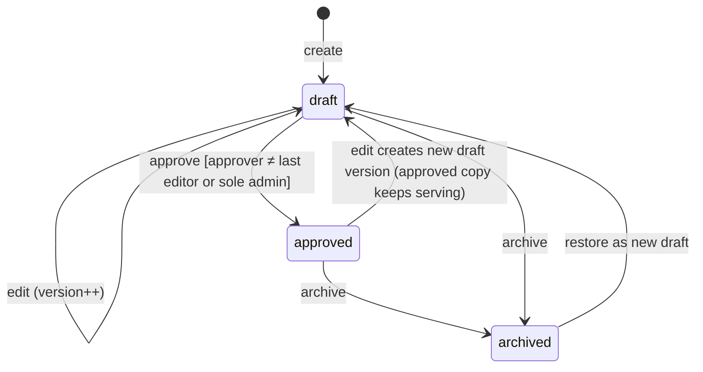
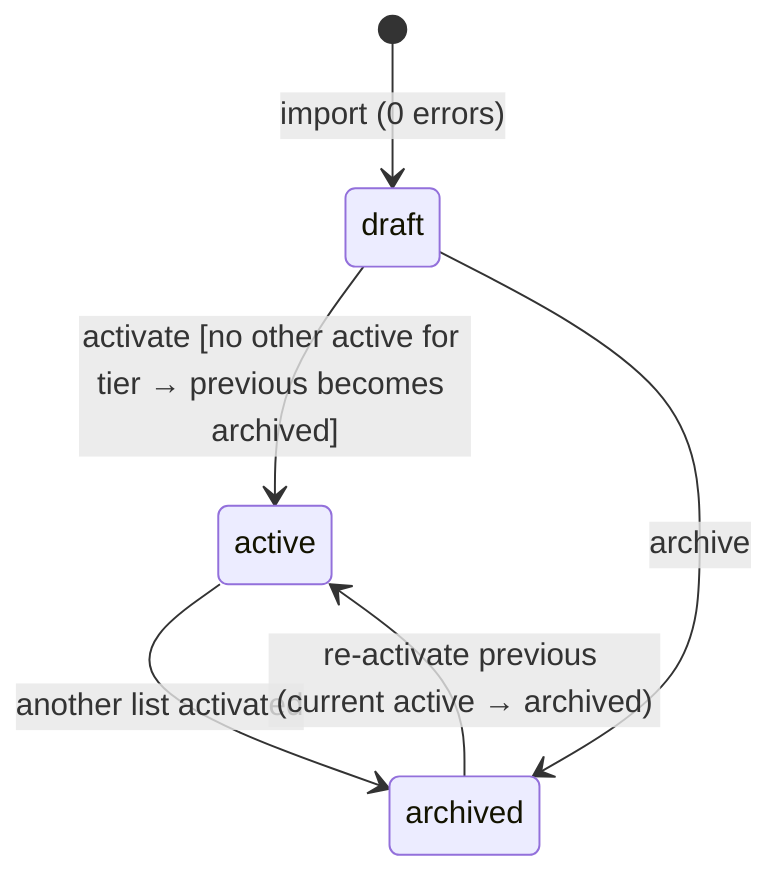
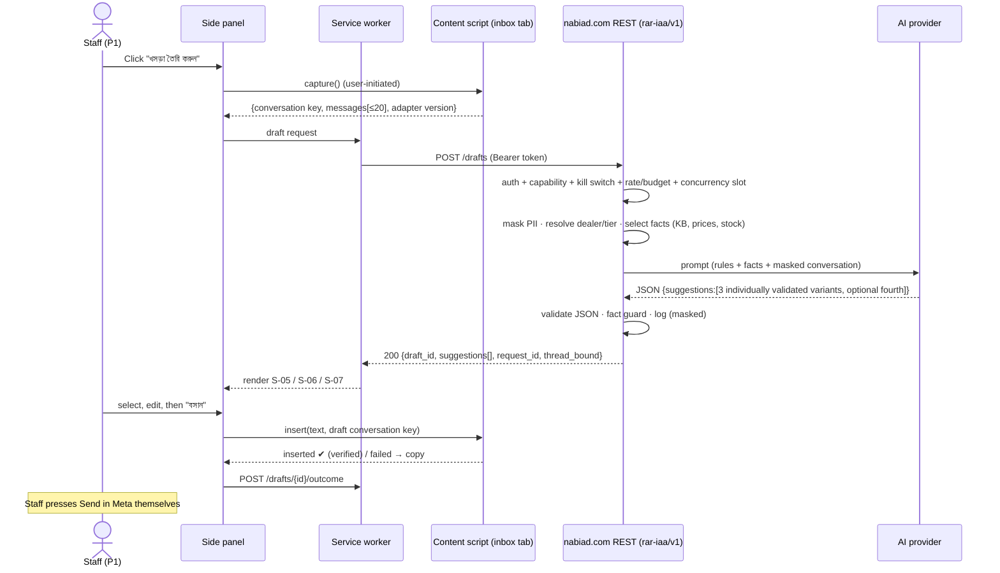
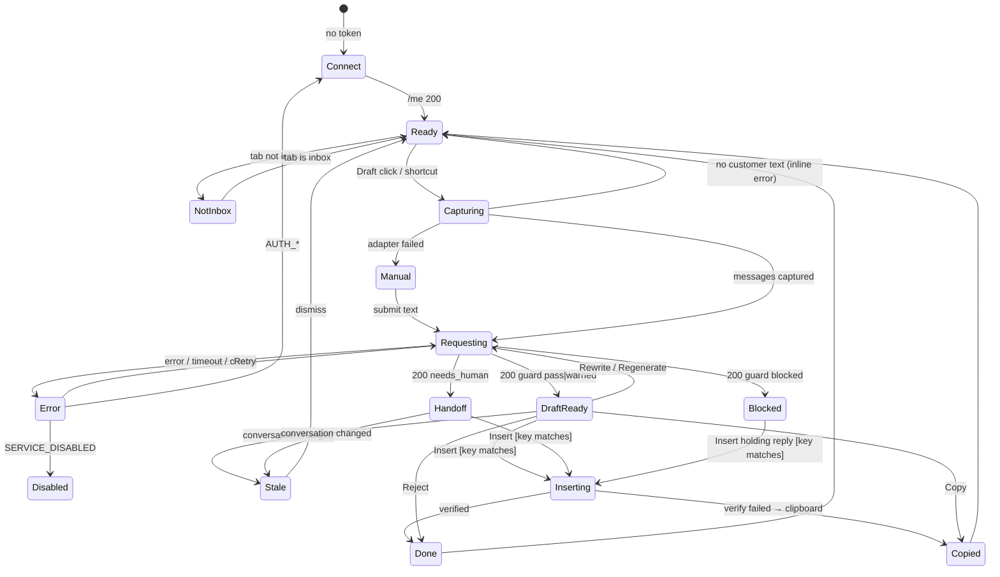

# 02 — Application Flow & State Machine Specification

**Status:** Draft v0.2 · 27 Oct 2026
**Related:** [01_PRD](01_PRD.md) · [03_UI_Spec](03_UI_Spec.md) · [04_TRD](04_TRD.md) · [05_Schema](05_Schema.md) · [06_Plan](06_Plan.md)

The product has two surfaces:

- **Extension side panel** (Chrome Side Panel next to Meta Business Suite) — used by P1.
- **wp-admin pages** on nabiad.com under the menu **"Inbox AI Assist"** — used by P2 and P3.

There are no public routes. Every route requires authentication.

---

## 1. Sitemap

```text
Chrome side panel (extension)            wp-admin (nabiad.com)
├── S-01 Connect                          └── Inbox AI Assist
├── S-02 Not on inbox                         ├── A-01 Overview           page=rar-iaa
├── S-03 Ready                                ├── A-02 Knowledge base     page=rar-iaa-kb
├── S-04 Generating                           │     └── A-02e Edit entry  page=rar-iaa-kb&action=edit&id=N | action=new
├── S-05 Reply suggestions (individual guards)         ├── A-03 Dealers & tiers    page=rar-iaa-dealers&tab=dealers|tiers
├── S-06 Handoff draft                        ├── A-04 Price lists        page=rar-iaa-prices
├── S-07 Blocked draft                        │     ├── A-04i Import      page=rar-iaa-prices&action=import
├── S-08 Error                                │     └── A-04v View list   page=rar-iaa-prices&action=view&id=N
├── S-09 Link dealer (dialog)                 ├── A-05 Access tokens      page=rar-iaa-tokens
├── S-10 Manual text (selection / paste)      ├── A-06 Logs               page=rar-iaa-logs&tab=drafts|audit
├── S-11 Quick answers (no-AI fallback)       └── A-07 Settings           page=rar-iaa-settings
├── S-12 Diagnostics & settings
└── S-13 Service disabled
```

## 2. Route inventory and access

### 2.1 Extension

The side panel is enabled only on tabs whose URL matches `https://business.facebook.com/latest/inbox/*` (CONFIRMED from the owner's screenshot URL; exact path pattern VERIFICATION REQUIRED in T0.02). On other tabs the panel shows S-02.

| View | Access | Shown when |
|---|---|---|
| S-01 Connect | Anyone with the extension | No token stored, or token rejected (AUTH_*) |
| S-02 Not on inbox | Connected | Active tab URL is not the inbox |
| S-03 Ready | Connected + `rar_iaa_use` | Inbox tab; panel idle |
| S-04 Generating | same | Request in flight |
| S-05 / S-06 / S-07 | same | Response received |
| S-08 Error | same | Request failed |
| S-09 Link dealer | `rar_iaa_link_dealer` | User opens it from S-03/S-05/S-06 |
| S-10 Manual text | `rar_iaa_use` | User chooses it, or adapter self-test failed |
| S-11 Quick answers | `rar_iaa_use` | User opens it, or provider error/budget/disabled-AI |
| S-12 Diagnostics | Connected | User opens ⚙ |
| S-13 Service disabled | Connected | API returns SERVICE_DISABLED |

### 2.2 wp-admin

| Route | Capability | Purpose |
|---|---|---|
| A-01 `admin.php?page=rar-iaa` | `rar_iaa_view_logs` | Usage today/month, health checks, kill-switch state (toggle needs `rar_iaa_manage_settings`) |
| A-02 `page=rar-iaa-kb` | `rar_iaa_manage_kb` (list/edit); approve button needs `rar_iaa_approve_kb` | KB list and editor |
| A-03 `page=rar-iaa-dealers` | `rar_iaa_manage_prices` | Dealers and tiers |
| A-04 `page=rar-iaa-prices` | `rar_iaa_manage_prices`; activate/rollback needs `rar_iaa_activate_prices` | Price-list import, preview, activation |
| A-05 `page=rar-iaa-tokens` | `rar_iaa_use` (own tokens); `rar_iaa_manage_settings` (all) | Issue and revoke extension tokens |
| A-06 `page=rar-iaa-logs` | `rar_iaa_view_logs` | Draft log and audit log |
| A-07 `page=rar-iaa-settings` | `rar_iaa_manage_settings` | Provider, keys, limits, language, roles, retention, kill switch |

Unauthorised access to any wp-admin route shows WordPress's standard "Sorry, you are not allowed to access this page." No redirect loops; the menu item is hidden for users without the capability.

## 3. Conversation identity

- **Conversation key** = the value of the `selected_item_id` URL query parameter together with `asset_id` (the Page), read from the inbox tab URL at capture time. (VERIFICATION REQUIRED: T0.02 must confirm these parameters change per conversation.)
- The server stores only `thread_hash = HMAC-SHA256(site_secret, asset_id + ":" + selected_item_id)`.
- If no key can be read, the draft is **unbound**: Insert is disabled; Copy works (AC-14.2).

## 4. Extension screens

Format: **Route → Access → Entry state → Components → User actions → Validation → API → Success → Failure → Next.**

### S-01 Connect
- **Access:** no token, or token rejected.
- **Entry:** panel opened; `chrome.storage.local` has no token, or last API call returned AUTH_INVALID / AUTH_REVOKED / AUTH_EXPIRED.
- **Components:** Header, `Iaa-TextField` (site URL, fixed to `https://nabiad.com`, read-only unless dev mode), `Iaa-TextField` (token, password-type), `Iaa-Button` primary "সংযোগ করুন", help text "wp-admin → Inbox AI Assist → Access tokens থেকে token নিন".
- **Actions:** Paste token → Connect.
- **Validation:** token matches `^iaa_[a-z0-9]{8}_[A-Za-z0-9]{40}$`; else inline error "Token ঠিক নেই".
- **API:** `GET /rar-iaa/v1/me`.
- **Success:** store token; show user name and role; → S-03 or S-02.
- **Failure:** 401 → "Token বাতিল বা মেয়াদ শেষ"; network → "nabiad.com-এ পৌঁছানো যাচ্ছে না" with Retry.
- **Next:** S-03 / S-02.

### S-02 Not on inbox
- **Entry:** active tab URL does not match the inbox.
- **Components:** EmptyState "Meta Business Suite Inbox খুলুন", link button opening `https://business.facebook.com/latest/inbox/all` in the current tab (user click only).
- **Next:** S-03 when the tab becomes the inbox (tab update listener; no polling).

### S-03 Ready
- **Entry:** inbox tab active; idle.
- **Components:** StatusBar (user, connected dot), DealerChip ("ডিলার: —" or "D-014 · Rahim Traders · Tier A"), primary button "খসড়া তৈরি করুন" (`Alt+Shift+D`), secondary "নির্বাচিত লেখা ব্যবহার" , ghost "পেস্ট করুন", link "দ্রুত উত্তর" (S-11), ⚙ (S-12), last request ID if any.
- **On entry:** the panel asks the content script for the current conversation key (URL only, no DOM read) and, if present, calls `GET /threads/current/link` (raw key in the `X-IAA-Thread` header; the server computes the hash) to show the DealerChip. This is the only automatic call and it reads no message text.
- **Actions:** Draft → capture (§6). Link dealer → S-09. Selection/Paste → S-10. Optional "পণ্য / নোট" field (v0.2.1, FR-29): text sent as `staff_note` with the next request for this conversation; cleared by "নতুন মেসেজ" or another conversation; never stored.
- **Validation:** capture must yield ≥ 1 customer text message, else inline "কাস্টমারের কোনো লেখা পাওয়া যায়নি" and no API call (AC-01.3).
- **API:** `POST /drafts`.
- **Next:** S-04.

### S-04 Generating
- **Components:** skeleton DraftCard, text "খসড়া তৈরি হচ্ছে…", Cancel button.
- **Actions:** Cancel aborts the fetch (AbortController); the server may still finish; its log row keeps outcome `pending`.
- **Timeout:** client aborts at 25 s → S-08 `CLIENT_TIMEOUT`.
- **Next:** S-05, S-06, S-07 or S-08.

### S-05 Suggestions ready
- **Components:** three stacked selectable SuggestionCards (Professional, Friendly, Short; optional fourth Sales-focused), each with FactChips, guard and handoff indicator. An explicit Select action loads one editable composer with Insert, Copy, Rewrite, Regenerate and Reject actions.
- **Actions:**
  - **Select:** choose exactly one variant ID and populate editable draft; no auto-send.\n  - **Insert:** post-edit commercial advisory + immediate account/asset/thread identity check (§7) → content script inserts → verify → `POST /drafts/{id}/outcome {inserted|edited_inserted}` → toast "রিপ্লাই বক্সে বসানো হয়েছে — দেখে Send করুন".
  - **Copy:** clipboard write → outcome `copied|edited_copied`.
  - **Rewrite:** `POST /drafts/{id}/rewrite {mode}` → S-04 → S-05 (one-step undo kept in memory).
  - **Reject:** optional reason select (ভুল তথ্য / ভাষা ভালো না / প্রাসঙ্গিক না / অন্য) → outcome `rejected`.
- **Validation:** edited text ≤ 2,000 chars; empty text disables Insert/Copy.
- **Failure:** insert verification fails → automatic copy + toast "Ctrl+V দিয়ে পেস্ট করুন" → outcome `copied` with `insert_failed=true`.

### S-06 Handoff draft
Same as S-05 plus a red-amber **HandoffBanner** "ম্যানেজারকে জানান — {reason}" at the top. Insert stays enabled (the draft is a safe holding reply).

### S-07 Blocked draft
- **Entry:** guard result `blocked`.
- **Components:** DangerBanner "খসড়ায় যাচাই-না-করা দাম ছিল, তাই আটকানো হয়েছে", holding reply in the textarea (server-generated, fact-free), the blocked numbers listed, buttons "বসান" (holding reply), "কপি", "আবার তৈরি".
- The blocked original text is **not** shown or logged as a usable draft (shown only to administrators in A-06 when masked logging is on).

### S-08 Error
One component, message by error code ([04_TRD §7](04_TRD.md#7-error-handling)):

| Code | Message (Bangla) | Actions |
|---|---|---|
| NETWORK / CLIENT_TIMEOUT | "সংযোগ সমস্যা। আবার চেষ্টা করুন।" | Retry · Quick answers |
| RATE_LIMITED | "একটু অপেক্ষা করুন ({retry_after} সেকেন্ড)।" | Retry enabled after countdown |
| BUSY | "সার্ভার ব্যস্ত, কয়েক সেকেন্ড পর চেষ্টা করুন।" | Auto-retry once after `retry_after`, then manual |
| BUDGET_EXCEEDED / DAILY_LIMIT | "আজকের/এই মাসের সীমা শেষ।" | Quick answers |
| AI_DISABLED / PROVIDER_NOT_CONFIGURED | "AI এখন বন্ধ আছে।" | Quick answers |
| CLIENT_TOO_OLD | "Extension আপডেট করুন (ন্যূনতম {min_version})।" | — |
| PROVIDER_* | "AI সার্ভিস সাড়া দিচ্ছে না।" | Retry · Quick answers |
| FORBIDDEN | "আপনার অনুমতি নেই।" | — |
| AUTH_* | → S-01 | — |
| SERVICE_DISABLED | → S-13 | — |
| VALIDATION_FAILED | "লেখা পড়া যায়নি" + detail | Manual text (S-10) |
| INTERNAL_ERROR | "ত্রুটি হয়েছে (ID …)" | Retry · Copy diagnostics |

### S-09 Link dealer (dialog)
- **Access:** `rar_iaa_link_dealer`; conversation key present.
- **Components:** Dialog, search field (debounced 300 ms, ≥ 2 chars), result list (code · name · tier · district), buttons "লিংক করুন", "লিংক সরান" (if linked), Cancel.
- **API:** `GET /dealers?search=&page=1&per_page=10`; `PUT /threads/current/link {dealer_id, expected_dealer_id}`; `DELETE /threads/current/link` (all with `X-IAA-Thread`).
- **Validation:** dealer must be `active`.
- **Success:** DealerChip updates; toast "ডিলার লিংক হয়েছে".
- **Failure:** 409 `LINK_CONFLICT` (changed by someone else) → reload link and show it; 404 → "ডিলার পাওয়া যায়নি".
- **Keyboard:** focus trapped; Esc closes; Enter selects highlighted result; arrow keys move.

### S-10 Manual text
- **Selection:** content script returns `window.getSelection().toString()` from the inbox tab; it becomes one customer message.
- **Paste:** textarea (≤ 4,000 chars); user marks "এটা কাস্টমারের লেখা".
- **Binding:** if the conversation key is readable from the URL the draft is bound; otherwise unbound (Copy only).
- **Next:** S-04 → S-05/06/07.

### S-11 Quick answers (no AI)
- **API:** `GET /kb/search?q=` (approved, in-date entries only; no provider call; no cost).
- **Components:** search field, result cards with answer (Bangla/English toggle), "কপি", "বসান" (bound conversations only).
- **Outcome:** `POST /kb/{id}/used` (counts usage; no text stored).

### S-12 Diagnostics & settings
Shows: extension version, connected user, site, adapter self-test (messages found ✔/✖, composer found ✔/✖, conversation key ✔/✖), last 5 request IDs and errors, buttons "Self-test", "Copy diagnostics" (masked), "Disconnect" (deletes token locally and calls `POST /tokens/self/revoke` if online), shortcut info (`chrome://extensions/shortcuts`).

### S-13 Service disabled
Banner "সার্ভিস বন্ধ আছে (অ্যাডমিন বন্ধ করেছেন)"; only S-12 and S-11 (if the toggle disables AI only) remain available. Checked again on next user action.

## 5. wp-admin screens

### A-01 Overview
- **Components:** cards: drafts today / limit, cost this month / cap (USD estimate), acceptance rate 7 days, handoff rate 7 days, active price lists per tier with dates, KB entries approved/expiring in 7 days; health checks (provider configured, test status, HTTPS, PHP version, DB schema version, WP-Cron/system cron for purge); kill switch toggle.
- **Actions:** toggle kill switch (confirm dialog "সব খসড়া বন্ধ হবে"); nonce-protected POST; audited.

### A-02 Knowledge base
- **List:** columns Title, Category, Status (draft/approved/archived), Effective, Updated by, Approved by. Filters: status, category, search (title/keywords/answer). Sort: updated desc (default), title. Pagination 20/page.
- **Editor (A-02e):** fields Title (required, ≤ 120), Category (select: hours, contact, ordering, delivery, payment, product_info, policy, greeting, other), Keywords (comma list, ≤ 30 items), Answer Bangla (required, ≤ 2,000), Answer English (optional, ≤ 2,000), Effective from (date, required, default today), Effective to (date, optional, ≥ from), Internal note.
- **Actions:** Save draft · Submit for approval (status stays `draft`, flag `pending_review`) · Approve (approver ≠ last editor unless sole admin) · Archive (confirm) · Restore archived as new draft · View history (versions).
- **Validation:** server-side; errors listed at top and inline. Saving an approved entry creates a new **draft version**; the approved version keeps serving until the new one is approved.
- **Optimistic concurrency:** form carries `row_version`; mismatch → "অন্য কেউ পরিবর্তন করেছেন" with reload link (no overwrite).



### A-03 Dealers & tiers
- **Tiers tab:** code (unique, `^[A-Z0-9_-]{1,20}$`), name, status. A tier with an active price list or active dealers cannot be deactivated (error explains why).
- **Dealers tab:** list with search (code/name), filters (tier, status, district), pagination 20; editor fields: dealer code (unique, required), name (required), tier (required), district (64-district select, optional), status, note. Deactivating a dealer keeps existing links but drafts treat it as unknown dealer (FR-05 rule).
- **CSV import of dealers** (P1): same preview pattern as A-04i.

### A-04 Price lists
- **List:** name, tier, status (draft/active/archived), effective from, rows, imported by/at. Filter by tier/status.
- **A-04i Import:** choose tier, name, effective-from date, CSV file (≤ 2 MB) → **Validate**. If there are errors: error table (row, column, message), duplicate codes, counts — **nothing is saved**; fix the CSV and upload again. If there are 0 errors: the list is saved as `draft` and the page redirects to A-04v with the banner "Draft saved — review, then Activate" (unknown `wc_product_id` values are shown as warnings).
- **A-04v View:** all rows, search; buttons "Activate" (needs `rar_iaa_activate_prices`; confirm dialog shows current active list and the new one), "Re-activate previous" on the previously active list, "Archive" for drafts.



Activation runs in one DB transaction with a named lock per tier (see [05_Schema §8](05_Schema.md#8-transactions-and-concurrency)).

### A-05 Access tokens
- **My tokens:** "Create token" → label (e.g. "Office PC 2"), expiry (30/90/180 days; default 180) → token shown **once** in a copy box with warning → list shows prefix, label, created, last used, expires, status → "Revoke" (confirm).
- **All tokens** (admins): same list with user column and filter; revoke any.

### A-06 Logs
- **Drafts tab:** date range (default today), user, outcome, guard result, handoff, dealer; columns time, user, dealer, language, guard, handoff, outcome, latency, cost, request ID. Detail drawer shows facts used and, only if masked logging is on, the masked input and draft. Export CSV (formula-injection safe).
- **Audit tab:** date, user, action, object; before/after diff view.

### A-07 Settings
Sections: Provider (provider, model, key source status, "Test connection"), Limits (per-user per minute, daily drafts, monthly USD cap, max concurrent calls 1–3), Language (Banglish reply script, digits, allow MRP mention, stock exact quantity [OD-3]), Privacy (masked logging on/off, retention days 7–90), Roles (staff role toggles), Uninstall (delete data), Kill switch. Every save is audited (keys never written to audit).

## 6. Draft request flow (end to end)



## 7. Panel state machine



**Guards and side effects**

| Transition | Guard | Side effect |
|---|---|---|
| Ready → Capturing | user gesture; tab is inbox | content script reads open conversation only |
| Capturing → Requesting | ≥ 1 customer text message | POST /drafts |
| * → Stale | `tabs.onUpdated` URL change gives a different conversation key than the draft's | Insert disabled; Copy allowed |
| DraftReady → Inserting | key read **again** immediately before insert equals the draft key | content script inserts text; never presses Send or Enter |
| Inserting → Done | composer text equals inserted text (normalised whitespace) | outcome logged |

## 8. Persona journeys

**P1 Inbox staff — daily**
1. Opens Chrome → Business Suite Inbox → opens the side panel once (it stays open per window).
2. Clicks a conversation → reads the message → clicks Draft (or `Alt+Shift+D`).
3. Checks fact chips/warnings → edits if needed → Insert → reviews in Meta's box → presses Send.
4. If the conversation is from a new dealer: Link dealer once.
5. If handoff: inserts the holding reply, tells the manager.

**P1 — first-time setup:** logs in to nabiad.com → A-05 creates a token → installs the extension (admin provides ZIP; "Load unpacked") → panel S-01 → pastes token → connected.

**P2 Manager — weekly:** reviews KB entries expiring soon on A-01 → edits/approves on A-02 → imports new price list on A-04 → activates → spot-checks 10 drafts on A-06.

**P3 Admin — setup:** installs plugin (after backup) → sets key in `wp-config.php` → A-07 test connection → limits → roles → issues tokens → pilot. **Emergency:** A-01 kill switch or `RAR_IAA_DISABLE` constant.

## 9. Network interruption and retry rules

- Only idempotent calls retry automatically: `GET` endpoints once after 1 s; `POST /drafts` **never** auto-retries except after `BUSY` with server `retry_after` (once).
- Each `POST /drafts` carries an `Idempotency-Key` (UUID v4); the server returns the stored result for a repeated key within 10 minutes instead of calling the provider again.
- `POST /outcome` is retried up to 3 times with backoff (1 s, 3 s, 9 s) from the service worker; losing it is acceptable.

## 10. Accessibility and keyboard

- Panel: logical tab order (status → dealer → main action → draft text → actions); visible focus ring ([03_UI_Spec §7](03_UI_Spec.md#7-accessibility)); `aria-live="polite"` region announces state changes ("খসড়া তৈরি", "সতর্কতা ২টি"); `role="alert"` for blocked/handoff banners.
- Shortcuts (Chrome `commands`, user can change): `Alt+Shift+D` draft; inside the panel `Ctrl+Enter` = Insert, `Ctrl+Shift+C` = Copy, `Esc` closes dialogs/cancels generating.
- Admin pages use WordPress core form markup with labels and error summaries linked to fields.

## 11. Story → flow traceability

| Story | Flows |
|---|---|
| US-01 | S-03 → S-04 → S-05, §6, §7 |
| US-02 | S-05 FactChips |
| US-03 | S-05 warnings, S-07 |
| US-04 | S-05 Insert/Copy, §7 guards |
| US-05 | S-05 rewrite |
| US-06 | S-09 |
| US-07 | S-06 |
| US-08 | A-02, KB state diagram |
| US-09 | A-04, price-list state diagram |
| US-10 | A-07, A-01, S-08 BUDGET |
| US-11 | A-05, S-01 |
| US-12 | A-01, A-07, S-13 |
| US-13 | A-06 |
| US-14 | S-10, S-12 self-test |

## 11. v0.2 selection / fallback state contract

S-05 contains a radiogroup of three independent reply cards (optionally four) with different tone, per-card facts/guards, and no preselected Send action. Select loads a draft textarea; user may Edit, Insert/Copy, or Reject. Rewrites retain the original factual scope. Blocked price claims become safe holding text only.

Before programmatic Insert, re-read current **tab + account + asset + thread** in the live SPA rather than trusting only prior URL navigation events. Missing identity or mismatch causes Stale and Copy-only; the extension never fires Enter/Send. Any edited figure, discount, product unit or promised time receives a visible pre-insert advisory; no silent edits.

Unknown/unlinked contact is explicitly labelled **Unverified — public facts only**, with no single-tier private-price fallback. If Meta policy/permission or composer compatibility fails, user-selected/pasted text + Copy remains a supported operational mode, not just an error state.

