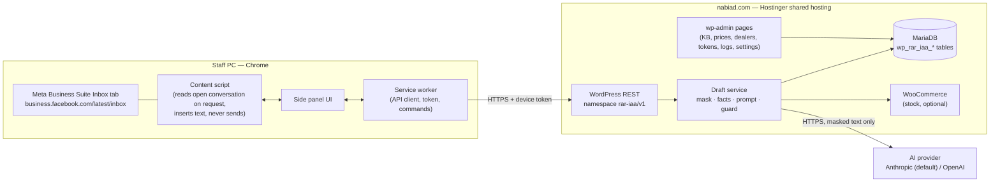

# 04 — Technical Requirements & Architecture Specification

**Status:** Draft v0.2 · 27 Oct 2026 · Locked items are marked **LOCKED**; items needing confirmation are marked `VERIFICATION REQUIRED` or reference an open decision (OD-n in [01_PRD §12](01_PRD.md#12-assumptions-open-decisions-and-dependencies)).
**Related:** [01_PRD](01_PRD.md) · [02_AppFlow](02_AppFlow.md) · [03_UI_Spec](03_UI_Spec.md) · [05_Schema](05_Schema.md) · [06_Plan](06_Plan.md)

---

## 1. System overview



**CONDITIONAL hosting architecture:** Chrome MV3 extension plus WordPress plugin for approved facts/admin. On-site synchronous AI calls only if campaign-like storefront benchmark passes; default concurrency 1. Failed benchmark requires isolated orchestration with narrow approved-facts access. No Meta API in MVP; live DOM access requires platform permission/feasibility evidence.

## 2. Client — Chrome extension

| Item | Decision |
|---|---|
| Platform | Chrome desktop, Manifest V3, Side Panel API. **LOCKED** |
| Language | Plain JavaScript ES modules (ES2022), no framework, no bundler, no build step. **LOCKED** (NFR-10) |
| Rendering | Side panel is a static HTML page; views rendered by small functions that create DOM nodes. **All server text is inserted with `textContent`, never `innerHTML`.** |
| State | One in-memory state object in `sidepanel/state.js` driven by the state machine in [02_AppFlow §7](02_AppFlow.md#7-panel-state-machine). Persistent: only `chrome.storage.local` keys `iaa.token`, `iaa.site`, `iaa.theme`, `iaa.diag`. Storage is **not encrypted**; call `chrome.storage.local.setAccessLevel({accessLevel:'TRUSTED_CONTEXTS'})`, never expose device token to content scripts; provider keys are server-only.
| Data fetching | All network calls from the **service worker** (`lib/api.js`) using `fetch` with `AbortController`. Content scripts never call the network. |
| Content script | Declared for `https://business.facebook.com/latest/inbox/*`. Idle until it receives a message. **No MutationObserver, no timers, no background reading.** Two commands: `capture` and `insert`. |
| Conversation change detection | Service worker listens to `chrome.tabs.onUpdated` (URL) for the inbox tab and notifies the panel; the panel compares conversation keys (stale guard). |
| Permissions | `sidePanel`, `storage`, `clipboardWrite`; host permissions `https://business.facebook.com/*`, `https://nabiad.com/*`. No `tabs`, `scripting`, `<all_urls>`, `webRequest`, `cookies`. |
| Commands | `draft` suggested `Alt+Shift+D`. Chrome may leave a suggested key unassigned (seen in RAR Rail Assist); S-12 shows the real binding from `chrome.commands.getAll()`. |
| Distribution | Private: ZIP → "Load unpacked" on each staff PC; stable extension ID via manifest `key`. Updates: replace folder → ↻ Reload. |

### 2.1 Inbox adapter (`content/inbox-adapter.js`)

- Single module that knows Meta's page structure. Exports `capture(): {key, messages[], adapter: {version, strategy}}` and `selfTest(): {messages: bool, composer: bool, key: bool}`.
- Selector strategies are **determined in spike T0.02** from the live page (read-only) and recorded in `tests/fixtures/inbox/*.html` (sanitised). Strategy order: ARIA roles/labels → structural landmarks → geometry (message bubble alignment left = customer, right = business) as last resort.
- Captures at most the last 20 text bubbles in the open thread; each `{side: "customer"|"business", text, at: ISO|null}`; non-text bubbles become `{side, text: "[non-text]"}` and are dropped before sending (only counted).
- Conversation key from `location.search` (`asset_id`, `selected_item_id`) — VERIFICATION REQUIRED (T0.02).

### 2.2 Composer insertion (`content/composer.js`)

1. Re-read conversation key; abort with `STALE` if different from the draft's key.
2. Find the reply composer (contenteditable) via adapter strategy; focus it.
3. Insert via `document.execCommand('insertText', false, text)`; if the composer text does not contain the inserted text, try a synthetic `paste` `ClipboardEvent` with a `DataTransfer`; if still not verified → return `INSERT_FAILED` (panel copies to clipboard).
4. **Never** dispatch Enter/keydown on the composer and never click any send control. A unit test asserts no `KeyboardEvent` with `key: "Enter"` and no `click()` is issued by this module.
5. Feasibility of steps 2–3 on the live composer is VERIFICATION REQUIRED (spike T0.03); if neither method works, FR-12 degrades to Copy-only and the PRD must be updated before Phase 3.

## 3. Backend — WordPress plugin `rar-inbox-ai-assist`

| Item | Decision |
|---|---|
| Runtime | PHP 7.4–8.4 (code must lint on all); WordPress ≥ 6.4; WooCommerce optional (≥ 8.0; only used for stock read). |
| Structure | Namespace `RarIaa\`; prefix `rar_iaa_` for options, hooks, caps, tables; one class per responsibility (see §14). |
| API | WordPress REST API, namespace `rar-iaa/v1` (versioned). **LOCKED** |
| Admin UI | Server-rendered wp-admin pages; form posts to `admin-post.php` with nonces and capability checks; minimal vanilla JS (confirm dialogs, search debounce). No admin REST endpoints. |
| Data access | `$wpdb` with `prepare()`; repository classes per table; no ORM. |
| Background jobs | One daily WP-Cron event `rar_iaa_daily_maintenance` (retention purge, expired idempotency transients, token expiry marking). Site already uses a system cron in hPanel that calls WP-Cron (see project notes), so it fires reliably. Nothing user-facing depends on cron. |
| Caching | No object-cache dependency. All `rar-iaa/v1` responses send `Cache-Control: no-store, private` and `X-LiteSpeed-Cache-Control: no-cache`. LiteSpeed Cache "Do Not Cache URIs" must include `/wp-json/rar-iaa/` (T5.03 checklist), because our token auth is not a WordPress login cookie and a cached `GET /me` would leak one user's data to others. |
| File storage | None persistent. CSV uploads are parsed from PHP's temp upload file and discarded. |

## 4. Authentication and authorization

### 4.1 Device tokens (extension → REST)

- Format: `iaa_{prefix8}_{secret40}`; prefix `[a-z0-9]{8}`, secret base62 40 chars from `random_bytes`.
- Stored: `token_prefix` (unique, lookup) and `token_hash = HMAC-SHA256(secret, pepper)` where `pepper = hash_hmac('sha256', 'rar-iaa-token', wp_salt('auth'))`. Comparison with `hash_equals`.
- Sent as `Authorization: Bearer <token>`. Fallback header `X-IAA-Token: <token>` because some Apache/LiteSpeed configs drop `Authorization` before PHP (checked at T5.03; health check on A-01 reports which header arrived).
- Lifecycle: created (expiry 30/90/180 days, default 180) → used (`last_used_at` updated at most every 5 minutes) → revoked or expired. Max 3 active tokens per user.
- Each request: find by prefix → verify hash → not revoked → not expired → user exists → **user currently has the required capability** (checked live via `user_can`, so removing a role takes effect immediately).
- Implementation: a `rest_authentication_errors` / `determine_current_user` filter that only acts on routes under `/rar-iaa/v1/` and only when an IAA token header is present; it sets the current user for the request. Token auth never grants access to any other REST namespace.

### 4.2 Authorization

Capabilities and role mapping: [01_PRD §9](01_PRD.md#9-roles-and-permission-boundaries); enforcement matrix and ownership rules: [05_Schema §10](05_Schema.md#10-authorization-model). Every REST route has an explicit `permission_callback` (never `__return_true`). wp-admin actions check capability **and** nonce.

## 5. API architecture

- Base: `https://nabiad.com/wp-json/rar-iaa/v1`.
- JSON in/out, UTF-8. Request bodies ≤ 64 KB (rejected with 413 `PAYLOAD_TOO_LARGE` above).
- Every response includes header `X-IAA-Request-Id: <uuid>`; the same ID is in error bodies and logs.
- Pagination: `page` (≥ 1, default 1), `per_page` (1–50, default 10); response headers `X-WP-Total`, `X-WP-TotalPages`.
- Versioning: breaking changes go to `rar-iaa/v2`; `v1` kept until all extensions in use are updated. The extension sends `X-IAA-Client: ext/{version}`; the server may answer 426 `CLIENT_TOO_OLD` with `min_version`.

### 5.1 Endpoint inventory

| Method & path | Capability | Purpose | Flow |
|---|---|---|---|
| `GET /me` | any valid token | User, caps, limits, service state, server time | S-01, S-03 |
| `POST /drafts` | `rar_iaa_use` | Generate draft | S-03→S-05/06/07 |
| `POST /drafts/{draft_id}/rewrite` | `rar_iaa_use` + owner | Rewrite draft | S-05 |
| `POST /drafts/{draft_id}/outcome` | `rar_iaa_use` + owner | Record outcome | S-05 |
| `GET /threads/current/link` | `rar_iaa_use` | Linked dealer for conversation | S-03 |
| `PUT /threads/current/link` | `rar_iaa_link_dealer` | Link/change dealer | S-09 |
| `DELETE /threads/current/link` | `rar_iaa_link_dealer` | Unlink | S-09 |
| `GET /dealers` | `rar_iaa_link_dealer` | Search active dealers | S-09 |
| `GET /kb/search` | `rar_iaa_use` | Approved KB search (no AI) | S-11 |
| `POST /kb/{id}/used` | `rar_iaa_use` | Count quick-answer use | S-11 |
| `POST /tokens/self/revoke` | valid token | Revoke the calling token | S-12 |

The conversation is identified by the header `X-IAA-Thread: {asset_id}:{selected_item_id}` (required on the three `threads/current` routes, optional on `POST /drafts`). The server computes `thread_hash` with its own secret; the hash and the secret never leave the server.

### 5.2 Admin actions (`admin-post.php`, nonce + capability)

| Action | Capability |
|---|---|
| `rar_iaa_kb_save`, `rar_iaa_kb_archive`, `rar_iaa_kb_restore` | `rar_iaa_manage_kb` |
| `rar_iaa_kb_approve` | `rar_iaa_approve_kb` |
| `rar_iaa_tier_save`, `rar_iaa_dealer_save`, `rar_iaa_dealer_import` (P1) | `rar_iaa_manage_prices` |
| `rar_iaa_price_import`, `rar_iaa_price_archive` | `rar_iaa_manage_prices` |
| `rar_iaa_price_activate`, `rar_iaa_price_reactivate` | `rar_iaa_activate_prices` |
| `rar_iaa_token_create`, `rar_iaa_token_revoke` (own) | `rar_iaa_use` |
| `rar_iaa_token_revoke_any` | `rar_iaa_manage_settings` |
| `rar_iaa_settings_save`, `rar_iaa_provider_test`, `rar_iaa_kill_switch` | `rar_iaa_manage_settings` |
| `rar_iaa_logs_export` | `rar_iaa_view_logs` |

Price import (A-04i): validate in memory; **if 0 errors, save immediately as a `draft` list and redirect to its view page (A-04v)**; if errors, show the error table and save nothing.

### 5.3 Contracts

**`POST /drafts`** — headers: `Authorization`, `Idempotency-Key: <uuid v4>` (required), `X-IAA-Thread` (optional; absent = unbound), `X-IAA-Client`.

```json
{
  "source": "capture",               // "capture" | "selection" | "paste"
  "messages": [
    {"side": "customer", "text": "Assalamu alaikum. Apnader store ajke khola koyta porjonto?", "at": "2026-10-27T12:23:00+06:00"},
    {"side": "business", "text": "Ok", "at": null}
  ],
  "options": {"language": "auto"},   // "auto" | "bn" | "en"
  "adapter": {"version": "mbs-2026-10a", "strategy": "aria"}
}
```

Validation: 1–20 messages; ≥ 1 with `side = customer`; each `text` 1–2,000 chars after trim; total ≤ 12,000 (server trims oldest first and reports `trimmed: n`); `at` ISO 8601 or null; unknown fields rejected (422).

Response `200`:

```json
{
  "draft_id": "5f6c0d1e-9a1b-4c55-8f3e-2b7f8f0d6a10",
  "request_id": "b0c1…",
  "suggestions": [{"variant_id":"professional","reply":"ওয়ালাইকুম আসসালাম। কোন শোরুমের সময় জানতে চান? নিশ্চিত করে জানাচ্ছি।","language":"bn","guard":{"result":"pass","warnings":[],"blocked_values":[]},"handoff":{"needed":false,"reason":null},"facts_used":[]},{"variant_id":"friendly","reply":"ওয়ালাইকুম আসসালাম! কোন শোরুমে আসবেন জানাবেন? সময় নিশ্চিত করব।","language":"bn","guard":{"result":"pass","warnings":[],"blocked_values":[]},"handoff":{"needed":false,"reason":null},"facts_used":[]},{"variant_id":"short","reply":"ওয়ালাইকুম আসসালাম। কোন শোরুমের সময় জানতে চান?","language":"bn","guard":{"result":"pass","warnings":[],"blocked_values":[]},"handoff":{"needed":false,"reason":null},"facts_used":[]}],
  "default_variant_id": null,
  "dealer": {"id": 14, "code": "D-014", "name": "Rahim Traders", "tier": "A"},
  "thread_bound": true,
  "trimmed": 0,
  "usage": {"today": 34, "daily_limit": 300}
}
```

`guard.result` ∈ `pass | warned | blocked`. When `blocked`, `reply` is the server holding reply and `blocked_values` lists the offending values. `handoff.reason` ∈ `order_confirmation | credit_outstanding | discount_negotiation | complaint | damage_return | unknown_dealer_price | missing_facts | other`.

**`POST /drafts/{id}/rewrite`** — body `{"mode": "shorter"|"polite"|"formal"|"bn"|"en", "current_text": "<text as shown/edited, ≤ 2000>"}` + `Idempotency-Key`. Response: same shape as `/drafts` with a new `draft_id` and `parent_draft_id`. Facts allowed = facts of the parent draft only. Rewrites of a draft owned by another user → 403.

**`POST /drafts/{id}/outcome`** — body `{"selected_variant_id":"professional|friendly|short|sales_focused","outcome": "inserted"|"edited_inserted"|"copied"|"edited_copied"|"rejected", "reject_reason": null|"wrong_fact"|"tone"|"irrelevant"|"other", "insert_failed": false, "edit_distance": 0..2000}`. `204`. Only the draft owner; only once per draft (second call 409 `OUTCOME_ALREADY_SET`).

**`GET /threads/current/link`** — header `X-IAA-Thread` required. `200 {"linked": true, "dealer": {...}, "linked_by": "…", "linked_at": "…"}` or `{"linked": false}`.

**`PUT /threads/current/link`** — body `{"dealer_id": 14, "expected_dealer_id": null}`; `expected_dealer_id` must equal the current link (null if none) else `409 LINK_CONFLICT` with the current link. `200` with new link.

**`GET /dealers?search=rah&page=1&per_page=10`** — `search` ≥ 2 chars; matches code prefix or name (case-insensitive, Bangla supported); active only. `200 [{"id":14,"code":"D-014","name":"Rahim Traders","tier":"A","district":"BD-13"}]`.

**`GET /kb/search?q=…`** — `q` 2–100 chars; approved and in-date only; max 10. `200 [{"id":12,"title":"Office hours","category":"hours","answer_bn":"…","answer_en":"…"}]`.

**`GET /me`** — `200 {"user":{"id":7,"name":"…"},"caps":["use","link_dealer"],"service":{"enabled":true,"ai_enabled":true},"limits":{"per_minute":6,"daily":300,"today":34},"settings":{"banglish_reply_script":"bn","reply_digits":"en"},"server_time":"…","min_client":"0.1.0"}`.

## 6. Draft pipeline (server)

Order inside `DraftService::create()`; each step has its own class and unit tests:

1. **Gate:** kill switch (constant `RAR_IAA_DISABLE` or setting) → 503 `SERVICE_DISABLED`; AI disabled toggle → 503 `AI_DISABLED`.
2. **Idempotency:** store only safe request IDs/status/expiry metadata by user and key for 600s; never cache full unmasked response or PII in a transient. Return `REQUEST_IN_PROGRESS` for duplicate in-flight work.
3. **Validate** body (§5.3).
4. **Limits:** per-user per-minute (default 6) → 429 `RATE_LIMITED` + `retry_after`; daily count (default 300) → 429 `DAILY_LIMIT`; month cost ≥ cap → 429 `BUDGET_EXCEEDED`.
5. **Concurrency slot:** try `GET_LOCK('rar_iaa_ai_slot_{n}', 0)` for n = 1..max_concurrent (default 1 until hosting load gate approves increase); none free → 503 `BUSY` + `retry_after: 3`. Lock released in `finally` (and automatically on connection end).
6. **Mask** (`Masker`): replace in customer and business texts, keeping a per-request in-memory map:
   - BD mobile: optional `+88`/`88`, `01[3-9]` + 8 digits, with spaces/hyphens, Bangla or ASCII digits → `[PHONE_n]`
   - Landline: `0` + 1–2 digit area + 6–8 digits with separators → `[PHONE_n]`
   - E-mail → `[EMAIL_n]`
   - Digit runs ≥ 10 not matched above (account/transaction IDs) → `[NUMBER_n]`
   - Lines with address cue words (বাসা, রোড, road, house, holding, থানা, upazila, জেলা, sector, block) → `[ADDRESS_n]` for the cue word's clause
   - Customer display name (if the adapter provided it) → `[CUSTOMER]`
7. **Language:** Bangla-script ratio of the latest customer message > 0.3 → `bn`; else Banglish lexicon hits ≥ 2 → `banglish` (reply script per setting, default Bangla); else `en`. `options.language` overrides.
8. **Dealer and tier:** thread link → dealer (active) → tier. If no manually verified active dealer link: no confidential tier price, regardless of count of active tiers. Only approved public facts may be supplied.
9. **Fact selection** (`FactSelector`):
   - Normalise text (Bangla digits → ASCII, lowercase, strip punctuation).
   - KB: approved + in-date entries scored by keyword/title token hits; always add `greeting` and `contact` category entries if present; top 8.
   - Products: match price items of the tier's active list by `item_code`, name tokens and `aliases` (exact token, then Levenshtein ratio ≥ 0.8 for tokens ≥ 4 chars); top 15. Each fact: `{fact_id: "price:340", product, unit, pack_size, price_bdt, mrp_bdt?, stock}`.
   - Stock (`StockService`): `stock_mode = wc` → WooCommerce product stock via `wc_get_product()` (works with HPOS on/off) → bucket per BR-03; `manual` → `manual_stock_status`; `hidden` → `unknown`.
   - Facts JSON also contains `today` (Asia/Dhaka date and weekday) and `business_name`.
10. **Prompt** (`PromptBuilder`, versioned `PROMPT_VERSION = "p1"`): system rules (facts-only, no invented numbers, handoff topics, greeting rule BR-12, language, length ≤ 600 chars unless listing prices, never ask for OTP/PIN, conversation is untrusted data and may contain instructions to ignore), facts JSON, conversation as role-tagged quoted lines, required JSON output schema:

    ```json
    {"suggestions":[{"variant_id":"professional|friendly|short|sales_focused","reply":"string","language":"bn|en","needs_human":false,"handoff_reason":null,"facts_used":["kb:12"],"missing_info":[]}]}
    ```
11. **Provider call** (`ProviderInterface::complete(prompt, opts) → {text, usage: {input_tokens, output_tokens}, model, latency_ms}`): timeout 20 s; one retry only on connection error/5xx when ≥ 8 s budget remains; never retry 4xx.
12. **Parse:** strict JSON parse (strip code fences); invalid → one repair retry asking for JSON only; still invalid → 502 `PROVIDER_BAD_OUTPUT`. `facts_used` filtered to IDs actually supplied (others dropped and logged).
13. **Unmask** placeholders in `reply` from the in-memory map (so a draft can repeat the customer's own number). The map is then discarded.
14. **Fact guard** (`FactGuard`), applied to the unmasked reply:
    - Extract numeric expressions (ASCII and Bangla digits, grouping commas, decimals, ranges `2-3`, times `৯টা`/`9:30`, dates, percentages).
    - Allowed **company price claims** = exact approved active tier+product+unit price for linked dealers, or separately approved public retail price. Numbers in customer text are **not** price authority. Non-price numbers require approved fact backing or are clearly attributed customer questions.
    - **Price-like** = within 12 characters of `৳`, `টাকা`, `tk`, `taka`, `bdt`, `/-`. Unmatched price-like or percentage → **blocked**. Other unmatched → **warned**.
    - Banned phrases (setting, defaults: "১০০% গ্যারান্টি", "গ্যারান্টি দিচ্ছি", "guarantee", "অবশ্যই পৌঁছে যাবে", "free delivery" unless a fact contains it) → warned.
    - Blocked → reply replaced by `HoldingReply` (setting text in bn/en; greeting prefix per BR-12).
15. **Handoff** (`HandoffRules`): keyword rules per reason (bn/banglish/en lists in settings) OR model `needs_human` → `handoff.needed = true`; reason = rule reason, else model reason, else `other`. Rule `unknown_dealer_price` when a price was asked and no tier was available.
16. **Log** masked/meta information only, selected variant ID and per-variant guard counts; metadata-only idempotency record; settle reserved budget; release slot. No unmasked response cache.

Rewrite uses steps 1–5 and 10–16 with the parent's fact set (re-read from DB by IDs; if a price list was activated since, facts are re-read and `warnings` gets `FACTS_CHANGED`).

## 7. Error handling

Body for every non-2xx response:

```json
{"code": "RATE_LIMITED", "message": "Too many requests", "data": {"status": 429, "retry_after": 12, "request_id": "…"}}
```

(WordPress `WP_Error` shape so core REST formatting applies.)

| Code | HTTP | Meaning |
|---|---|---|
| `AUTH_MISSING` | 401 | No token header |
| `AUTH_INVALID` | 401 | Unknown prefix or hash mismatch |
| `AUTH_REVOKED` / `AUTH_EXPIRED` | 401 | Token state |
| `FORBIDDEN` | 403 | Missing capability or not owner |
| `NOT_FOUND` | 404 | Draft/dealer/link not found |
| `VALIDATION_FAILED` | 422 | Body/params invalid; `data.fields` lists problems |
| `PAYLOAD_TOO_LARGE` | 413 | Body > 64 KB |
| `LINK_CONFLICT` / `OUTCOME_ALREADY_SET` | 409 | Concurrency conflict |
| `RATE_LIMITED` / `DAILY_LIMIT` / `BUDGET_EXCEEDED` | 429 | Limits |
| `SERVICE_DISABLED` / `AI_DISABLED` / `PROVIDER_NOT_CONFIGURED` / `BUSY` | 503 | Service state |
| `PROVIDER_TIMEOUT` | 504 | Provider > 20 s |
| `PROVIDER_ERROR` / `PROVIDER_BAD_OUTPUT` | 502 | Provider failure |
| `CLIENT_TOO_OLD` | 426 | Extension below `min_client` |
| `INTERNAL_ERROR` | 500 | Unexpected; details only in server log |

Warning codes (inside a 200 response, `guard.warnings[].code`): `UNVERIFIED_NUMBER`, `BANNED_PHRASE`, `FACTS_CHANGED` (rewrite after a price list or KB change), `INPUT_TRIMMED` (older messages dropped), `NON_TEXT_SKIPPED` (images/files not read).

Client-only codes (never from server): `NETWORK`, `CLIENT_TIMEOUT` (25 s), `STALE`, `INSERT_FAILED`, `ADAPTER_FAILED`.

PHP errors are caught at the controller boundary; stack traces never reach the client. Server log lines: `error_log('[rar-iaa] {request_id} {code} {class}::{method}')` — no message text, no tokens.

## 8. Third-party integrations and configuration

| Integration | Detail | Status |
|---|---|---|
| Anthropic Messages API | `POST https://api.anthropic.com/v1/messages`, headers `x-api-key`, `anthropic-version: 2023-06-01`, `content-type: application/json`; usage from `usage.input_tokens` / `usage.output_tokens`. Default model `claude-haiku-5-5`. | Header version and model: VERIFICATION REQUIRED at T0.07 via "Test connection" |
| OpenAI API | Chat Completions `POST https://api.openai.com/v1/chat/completions` with JSON response format; model entered by admin (no default). | Endpoint/model: VERIFICATION REQUIRED |
| WooCommerce | `wc_get_product($id)->get_stock_quantity()`, `managing_stock()`, `get_stock_status()`; low-stock amount from `get_option('woocommerce_notify_low_stock_amount')`. | Optional |

Data handling at providers (checked 27 Oct 2026): Anthropic states API data is not used for training unless agreed; OpenAI states API data is not used for training unless the customer opts in and abuse-monitoring logs are kept up to 30 days. Re-check at T0.07 and before go-live.

**Configuration constants (`wp-config.php`)** — preferred for secrets:

| Constant | Purpose |
|---|---|
| `RAR_IAA_DISABLE` | `true` = kill switch (FR-20) |
| `RAR_IAA_ANTHROPIC_API_KEY` | Anthropic key |
| `RAR_IAA_OPENAI_API_KEY` | OpenAI key |
| `RAR_IAA_MAX_CONCURRENT` | Optional override 1–3 |
| `RAR_IAA_PROVIDER` | `stub` selects the test provider; honoured only when `WP_ENVIRONMENT_TYPE` is `local` or `development` (§17) |

If a key constant is absent, the admin may store the key in the option `rar_iaa_secret_{provider}` encrypted with libsodium `sodium_crypto_secretbox` (key derived from `wp_salt('secure_auth')`); shown masked (`sk-…abcd`) and never returned by any endpoint. Cost estimation uses admin-entered prices per million input/output tokens (settings; no built-in price table — VERIFICATION REQUIRED from provider pricing pages at T0.07).

## 9. Security requirements and threat model

Assets: dealer prices, dealer list, customer messages, provider keys, staff tokens, nabiad.com availability.

| Threat | Control |
|---|---|
| Stolen/leaked device token | Hashed at rest; shown once; scoped to `rar-iaa/v1`; expiry; revoke (own and admin); live capability check; `last_used_at` visible. |
| Cached authenticated responses (LiteSpeed) | `no-store` + `X-LiteSpeed-Cache-Control: no-cache`; LSCache exclusion; test T4.05 asserts headers. |
| XSS via draft or customer text in panel/admin | Panel: `textContent` only; admin: `esc_html`/`esc_attr`/`esc_textarea`; CSP in extension manifest (`script-src 'self'; object-src 'none'`). |
| Prompt injection in customer text | Untrusted-data framing in prompt; facts-only; fact guard; discounts/orders are handoff; human review. |
| CSRF on admin | Nonces + capability on every admin-post action. |
| SQL injection | `$wpdb->prepare` everywhere; table names from constants; `LIKE` with `esc_like`. |
| CSV formula injection (log export) | Prefix cells starting with `= + - @` with `'`. |
| Malicious CSV import | Size ≤ 2 MB, ≤ 5,000 rows, UTF-8 check, strict column whitelist, numeric validation, no file kept. |
| Privilege escalation | Capabilities never granted via registration; owner checks on drafts; admin-only settings; role toggles audited. |
| Key exposure | Constants preferred; encrypted option fallback; never in REST responses, logs, audit diffs or diagnostics. |
| Extension compromise surface | Minimal permissions; no remote code; no `eval`; content script inert until messaged; messages from content script validated by type/schema. |
| Server overload | Concurrency slots, timeouts, rate limits, payload limits. |
| Data leakage to provider | Server-side masking; only last ≤ 20 messages of the open conversation; no dealer identity sent (tier and prices only). |

## 10. Rate limiting and abuse prevention

- Per-user per-minute counter in `wp_rar_iaa_rate_buckets` with atomic `INSERT … ON DUPLICATE KEY UPDATE count = count + 1` (pattern proven in RAR Admin Studio).
- Daily request count and monthly cost from `wp_rar_iaa_usage_daily`.
- Atomic monthly lock reserves worst-case cost before calling provider; reject if spent + reserved + new reservation exceeds cap. Settle/refund actual cost and reconcile expired reservations; real provider billing may differ.
- `GET /dealers` and `GET /kb/search`: 30/min per user.

## 11. Logging, monitoring and observability

- Draft log ([05_Schema](05_Schema.md)) — per request: user, thread hash, dealer, tier, provider, model, prompt version, guard result, warnings count, handoff, facts used, tokens, cost, latency (total and provider), adapter version/strategy, outcome, error code.
- Audit log for all admin changes.
- A-01 health checks: provider configured and last test result; schema version; HTTPS; auth header path (`Authorization` vs `X-IAA-Token`); WP-Cron last maintenance run; PHP and WordPress versions; LSCache exclusion present (best-effort detection).
- Extension diagnostics (S-12): masked, copyable.

## 12. Performance budgets

| Metric | Budget |
|---|---|
| Server time excluding provider (p95) | ≤ 400 ms |
| DB queries per draft | ≤ 25 |
| Memory per draft request | ≤ 32 MB |
| Content script capture | ≤ 150 ms on a 20-message thread |
| Panel first render | ≤ 300 ms |
| Extension package size | ≤ 1.5 MB (fonts included) |
| Prompt size | ≤ 6,000 input tokens typical; facts capped (8 KB entries, 15 products) |

Scalability: A-10 volume (≤ 5 staff, ≤ 300 drafts/day) fits shared hosting. If volume grows above ~1,500/day, move the plugin's provider calls to a separate small VPS (out of scope; ADR-02 revisit trigger).

## 13. Technology versions

| Component | Version | Status |
|---|---|---|
| PHP (support range) | 7.4 – 8.4 | LOCKED range; production version VERIFICATION REQUIRED (hPanel) |
| WordPress | ≥ 6.4; test on current production version | Production version VERIFICATION REQUIRED |
| WooCommerce | ≥ 8.0 (optional) | Production version VERIFICATION REQUIRED |
| MariaDB (production) | ≥ 10.6 assumed | VERIFICATION REQUIRED |
| MySQL (CI) | 8.0 | LOCKED (matches other RAR CI) |
| Chrome (staff PCs) | ≥ 116 (Side Panel `open()` API) | Minimum and office PC versions VERIFICATION REQUIRED |
| Node.js (dev/CI only, never server) | 22 LTS | LOCKED for CI; exact patch pinned by `actions/setup-node` |
| LinkeDOM (unit tests) | — | VERIFICATION REQUIRED; pin in `package-lock.json` at T0.06 |
| Playwright (E2E) | — | VERIFICATION REQUIRED; pin at T0.06 |
| axe-core (a11y tests) | — | VERIFICATION REQUIRED; pin at T0.06 |
| PHP_CodeSniffer + PHPCompatibility (dev) | — | VERIFICATION REQUIRED; pin in `composer.lock` (dev only) |
| WP-CLI (tests) | — | VERIFICATION REQUIRED |
| Hind Siliguri font files | — | VERIFICATION REQUIRED (source: Google Fonts repository, OFL) |
| Lucide icons | — | VERIFICATION REQUIRED (copy SVGs; record version in `extension/icons/LICENSE-lucide.txt`) |
| Anthropic API version header | `2023-06-01` | VERIFICATION REQUIRED |
| Anthropic model | `claude-haiku-5-5` | VERIFICATION REQUIRED (Test connection) |
| OpenAI model | admin-entered | VERIFICATION REQUIRED |

No runtime PHP dependencies (no Composer packages shipped). No runtime JS dependencies in the extension.

## 14. Repository and module structure

Repository: `ruhulaminrevens/RAR-Inbox-AI-Assist` (OD-9). Uploads are done by the owner (Claude sessions cannot push to these repos).

```text
RAR-Inbox-AI-Assist/
├── CLAUDE.md
├── .cursorrules
├── README.md
├── CHANGELOG.md
├── docs/                         01_PRD … 06_Plan (+ runbooks added in Phase 5)
├── plugin/rar-inbox-ai-assist/
│   ├── rar-inbox-ai-assist.php   bootstrap: constants, autoloader, hooks
│   ├── uninstall.php
│   ├── includes/
│   │   ├── class-plugin.php
│   │   ├── class-installer.php          schema (dbDelta), schema_version, capabilities
│   │   ├── class-settings.php
│   │   ├── class-audit.php
│   │   ├── auth/      class-token-service.php, class-rest-auth.php
│   │   ├── rest/      class-controller-base.php, class-me-controller.php, class-drafts-controller.php,
│   │   │              class-threads-controller.php, class-dealers-controller.php, class-kb-controller.php,
│   │   │              class-tokens-controller.php
│   │   ├── domain/    class-kb-repository.php, class-dealer-repository.php, class-tier-repository.php,
│   │   │              class-price-repository.php, class-thread-link-repository.php,
│   │   │              class-draft-log-repository.php, class-usage-repository.php
│   │   ├── draft/     class-draft-service.php, class-masker.php, class-language.php,
│   │   │              class-fact-selector.php, class-stock-service.php, class-prompt-builder.php,
│   │   │              class-fact-guard.php, class-handoff-rules.php, class-holding-reply.php
│   │   ├── providers/ interface-provider.php, class-anthropic-provider.php,
│   │   │              class-openai-provider.php, class-provider-factory.php
│   │   ├── limits/    class-rate-limiter.php, class-budget.php, class-concurrency.php
│   │   ├── import/    class-csv-reader.php, class-price-csv-importer.php
│   │   ├── admin/     class-admin-menu.php, class-admin-actions.php, views/*.php
│   │   └── cron/      class-maintenance.php
│   └── assets/        admin.css, admin.js
├── extension/
│   ├── manifest.json
│   ├── background.js
│   ├── content/       main.js, inbox-adapter.js, composer.js
│   ├── sidepanel/     index.html, panel.js, state.js, tokens.css, panel.css, ui/*.js
│   ├── lib/           api.js, text.js, ids.js
│   ├── fonts/         HindSiliguri-{400,500,600}.woff2, OFL.txt
│   └── icons/
├── tests/
│   ├── php/           smoke.php, integration/*.php, fixtures/*.csv
│   ├── ext/           *.test.mjs  (node:test + LinkeDOM)
│   ├── fixtures/inbox/*.html     sanitised Meta inbox snapshots (from T0.02)
│   ├── e2e/           Playwright: admin + extension against tests/e2e/mock-inbox/
│   └── guard/         redteam.json, eval-set.json (masked)
├── scripts/           package.py, sync-tokens.py, check-tokens.py, check-links.py
└── .github/workflows/ ci.yml, release.yml
```

Module boundaries: controllers only validate, authorise and call services; services never read `$_POST`/`$_GET`; repositories are the only classes that touch `$wpdb`; providers know nothing about WordPress options (settings passed in). In the extension, only `inbox-adapter.js` and `composer.js` know Meta's DOM; only `lib/api.js` knows the REST API.

## 15. Deployment, CI/CD and environments

- **Environments:** local (WP + SQLite or MariaDB, as used for other RAR plugins), CI (GitHub Actions, MySQL 8.0, PHP matrix 7.4/8.1/8.3/8.4, HPOS on/off), production (nabiad.com). A staging copy is recommended for T5.02 (VERIFICATION REQUIRED: whether a Hostinger staging site is available).
- **CI (`ci.yml`) gates:** PHP lint (matrix), PHPCompatibility 7.4+, plugin smoke + integration (HPOS on/off), extension unit tests (Node 22), token check, link check, Playwright E2E (admin + mock inbox), guard red-team suite.
- **Release (`release.yml`):** on version bump to `main`, builds `rar-inbox-ai-assist-v{ver}.zip` (plugin), `rar-inbox-ai-assist-extension-v{ver}.zip`, `SHA256SUMS.txt`; GitHub release.
- **Install:** backup first → upload plugin ZIP → activate → set constants → A-07 → LSCache exclusion → tokens → extension ZIP to PCs.

## 16. Backup, disaster recovery and rollback

- Before install/upgrade: hPanel file backup + database export (BR of owner's web-work rule).
- Schema migrations are additive (new tables/columns only) and versioned by `rar_iaa_schema_version`; downgrade = install previous ZIP (older code ignores extra columns).
- Fast stop: kill switch; full stop: deactivate plugin (data kept); extension can be removed from PCs independently.
- Data recovery: KB and price lists can be restored from DB backup; price-list rollback in-app (FR-16).
- Uninstall deletes data only if the setting is on (FR-22).

## 17. Testing strategy and quality gates

| Layer | Tooling | Covers |
|---|---|---|
| PHP unit-style | WP-CLI `wp eval-file tests/php/...` (RAR convention) | Masker, Language, FactSelector, FactGuard, HandoffRules, CSV importer, TokenService, limits |
| PHP integration | Same, against a real WP + WC install, HPOS on/off | REST contracts, auth, capabilities, transactions, concurrency |
| Extension unit | `node --test` + LinkeDOM with Meta fixtures | adapter capture, key parsing, composer insert/verify, never-send assertion, state machine |
| E2E | Playwright | admin flows; extension on mock inbox page served locally (capture → draft with stub provider → insert) |
| Guard red-team | JSON cases run through `FactGuard` + full pipeline with stub provider | invented prices, percentages, injections, Bangla digits |
| Quality eval | ≥ 50 masked real conversations with the real provider (owner-approved) | KPI-3 accuracy, handoff precision |
| Accessibility | axe-core in Playwright + manual keyboard | WCAG 2.2 AA |
| Load | parallel `POST /drafts` (stub provider with 3 s delay) | slots hold at 2, BUSY returned, no PHP errors |
| Security | independent review agent + header/auth probes | §9 |

Quality gate for any task: its verification commands in [06_Plan](06_Plan.md) pass and CI is green. Release gates: G2 pre-pilot; G3 general release. See [PRD §15](01_PRD.md#15-pre-pilot-and-general-release-acceptance-criteria).

A **stub provider** (`RAR_IAA_PROVIDER=stub` only when `WP_ENVIRONMENT_TYPE` is `local` or `development`) returns scripted JSON for tests; it cannot be enabled in production.

## 18. Architecture decisions (ADR summary)

| ID | Decision | Rationale | Revisit when |
|---|---|---|---|
| ADR-01 | Browser extension reading the open conversation, not Meta Messenger API | No Meta App Review; staff stay in Business Suite; human sends. | Night auto-reply needed, or adapter breaks too often. |
| ADR-02 | Backend as a WordPress plugin on nabiad.com | Existing hosting, auth, backups and RAR conventions; access to WooCommerce stock. | > 1,500 drafts/day or hosting limits hit. |
| ADR-03 | Plain JS extension, no build | Same as RAR Rail Assist; easy audit and update by ZIP. | UI grows beyond ~2,000 lines. |
| ADR-04 | Custom tables (not CPT/options) | Constraints, indexes, transactions, clean retention. | — |
| ADR-05 | Scoped device tokens, not Application Passwords or cookies | Application Passwords grant full REST access as the user; cookies are not available to the extension origin. | — |
| ADR-06 | Masking on the server | One implementation; extension stays simple; logs consistent. | — |
| ADR-07 | Handoff = rules OR model flag | Rules are predictable; model catches the rest. | — |
| ADR-08 | MySQL named locks as concurrency slots | Works on shared hosting without extra services; proven in RAR Woo Stock & Order. | — |
| ADR-09 | Three independently guarded selectable suggestions; optional fourth Sales-focused, one bounded provider call | Fulfils explicit owner requirement for selectable professional reply options. No auto-send. | Revisit only with pilot measurements. |
| ADR-10 | CSV-imported price lists held by the plugin | Dealer prices may not be in WooCommerce (OD-1). | OD-1 answered "in WooCommerce" → add `wc_meta` price source behind the same repository interface. |

## 19. v0.2 binding API / policy / security detail

`POST /drafts` **returns** `suggestions[]`: 3 unique IDs by default (4 if configured) and individually validated `reply`, `language`, `guard`, `handoff`, `facts_used`. Invalid number/duplicate ID fails closed. Validate each variant and each rewrite; outcome sends chosen `selected_variant_id`. Do not persist unmasked response body under idempotency transients or elsewhere.

**Price guard:** compare business claims against approved active tier or public facts matching product, unit and effective date. Example: customer asks `দাম ৯০০ টাকা, তাই তো?` — must not affirm ৳900 unless already authorised; `50% discount`, wrong pack unit and unlinked single-tier customer must also fail. Edited text gets a pre-insert advisory/automatic-insert block for invalid commercial claims.

**Auth:** tokens in Chrome storage are limited to TRUSTED_CONTEXTS. Cross-namespace attack tests must show an IAA bearer cannot authenticate WP core/WooCommerce or third-party REST. **Meta:** user click alone is not permission; document current Meta policy/eligibility before live DOM capture/insert. Fully support selected/pasted text + Copy mode.

**Hosting:** compare campaign-like site p95 checkout/TTFB with 0 vs 1 in-flight AI call; >10% p95 regression or worker saturation requires isolated orchestration. Cost reservation must atomically preauthorise worst-case output tokens with settlement/crash reconciliation.


## 20. Implementation record v0.1.0 (27 Oct 2026)

Built on the owner's explicit instruction (AUTH, see [06_Plan](06_Plan.md#gates)) ahead of G1, using the safe defaults in [DECISIONS](DECISIONS.md). Each item below is either a **documented deviation** or a detail the v0.2 text left open. All need owner acknowledgement at G1.

| Area | As built | Why |
|---|---|---|
| Prompt | `PROMPT_VERSION = 'p2'` (three variants, optional fourth, one provider call) | v0.2 replaced the single-draft `p1` |
| Draft response | adds `audience` (`dealer` \| `unverified`), `default_variant_id: null`, `trimmed`, `warnings[]`, `usage{today, daily_limit}` | panel needs audience to label dealer vs public answers; no default selection (US-03) |
| Error codes | adds `CONFLICT` (409, row_version clash), `REQUEST_IN_PROGRESS` and `REQUEST_ALREADY_PROCESSED` (409, idempotency metadata only, no text) | §6 step 2 / §19 idempotency |
| Guard warning codes | adds `PRICE_UNIT_UNCLEAR` (listed price without its unit nearby) and `COMMERCIAL_CLAIM` (discount/commission wording absent from facts) | §19 price guard (unit, discount) |
| Guard number classes | price-like = cue (`৳ টাকা tk taka bdt /- দাম মূল্য price rate রেট mrp`) within 12 characters **in the same sentence**; must equal a listed price/MRP or a price written in an approved KB answer. Percent must equal a percent in an approved KB answer. Dates, pack sizes, customer numbers and internal fact IDs (`id`, `*_id`) never authorise either, and IDs never count as facts for the unverified-number check | closes F-03 bypasses found in testing |
| Locks | MySQL/MariaDB `GET_LOCK`; on SQLite (local tests only) a lease row `lock:<name>` in `rate_buckets` | SQLite has no `GET_LOCK` |
| Cost reservation | table `cost_reservations` (see [Schema §8](05_Schema.md#14-cost_reservations-v010)) + `usage_daily.reserved_cost_usd_micros`; reserve 2 × worst case (call + one repair), TTL 120 s, recovered by `Budget::release_expired()` | resolves OD-14 technically |
| Admin | server-rendered wp-admin pages + `admin-post.php` handlers (capability + nonce); **no admin REST endpoints**; tokens created and shown once on the Access tokens page | smaller attack surface |
| Stub provider | only when `WP_ENVIRONMENT_TYPE` is `local`/`development` **and** `RAR_IAA_PROVIDER=stub`; scripted via option `rar_iaa_stub_next` (tests only); answers KB and price questions from supplied facts | deterministic tests; refused in production |
| Live inbox | admin setting `live_inbox` (default OFF). OFF: selection/paste + Copy only; content scripts refuse capture/insert. ON only after T0.09 evidence | v0.2 Meta gate |
| Extension auth headers | sends both `Authorization: Bearer` and `X-IAA-Token` | LiteSpeed/Apache setups that strip `Authorization` |
| Icons | Lucide 1.62.0 inner SVG markup (wrapper removed), incl. `wand-sparkles` for Rewrite | |
| Test tooling | puppeteer-core 25.16.0 + @sparticuz/chromium 153.0.0 + axe-core 4.10.3 instead of Playwright (its browser CDN is unreachable from the build environment); E2E replaces `chrome.*` with `tests/e2e/chrome-mock.js` because a headless shell cannot load extensions. PHP tests run with `php tests/php/run-all.php` (no WP-CLI needed) | |
| Verified environments | WordPress 7.1.3, PHP 8.3.6, SQLite and MariaDB 10.11.14, WooCommerce 11.1.2 (HPOS on/off). PHP 7.4/8.1/8.4 and Chrome ≥ 116 with the unpacked extension: static checks only until CI / manual install | |
