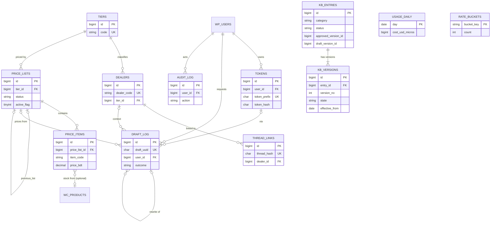

# 05 — Database Schema, Data Integrity & Authorization

**Status:** Draft v0.2 · 27 Oct 2026
**Related:** [01_PRD](01_PRD.md) · [02_AppFlow](02_AppFlow.md) · [03_UI_Spec](03_UI_Spec.md) · [04_TRD](04_TRD.md) · [06_Plan](06_Plan.md)

---

## 1. Engine and conventions

- **Engine:** the nabiad.com WordPress database — MariaDB in production (≥ 10.6 assumed, VERIFICATION REQUIRED at T0.07); MySQL 8.0 in CI. InnoDB, `utf8mb4` / the site's `utf8mb4` collation (from `$wpdb->get_charset_collate()`).
- **Prefix:** `{$wpdb->prefix}rar_iaa_` (shown below as `wp_rar_iaa_`).
- **Creation:** `dbDelta()` in `Installer`, schema version option `rar_iaa_schema_version` (this document = **1**).
- **Times:** `DATETIME` in **UTC** (`*_at` columns); business dates (`effective_from`, `effective_to`, `day`) are **Asia/Dhaka** dates.
- **IDs:** `BIGINT UNSIGNED AUTO_INCREMENT` primary keys; public draft IDs are UUID v4 (`draft_uuid`).
- **Money:** `DECIMAL(12,2)` BDT; provider cost in **USD micros** (`BIGINT`, 1 USD = 1,000,000).
- **Foreign keys and CHECK constraints:** WordPress `dbDelta()` cannot create or maintain them reliably, so they are **enforced in repository code** (validation before write, existence checks, no hard delete of referenced rows) and verified by integrity tests (T1.02: orphan queries must return 0). They are documented below as logical constraints.
- **Optimistic concurrency:** editable tables carry `row_version INT UNSIGNED NOT NULL DEFAULT 1`; updates use `WHERE id = %d AND row_version = %d` and increment it.

## 2. Entity relationship diagram



## 3. Table inventory

| Table | Purpose | Requirements |
|---|---|---|
| `wp_rar_iaa_kb_entries` | Logical KB entry and which version serves | FR-04, FR-15, FR-23 |
| `wp_rar_iaa_kb_versions` | Content and approval history of each entry | FR-15, NFR-12 |
| `wp_rar_iaa_tiers` | Dealer price tiers | FR-05, FR-16 |
| `wp_rar_iaa_dealers` | Dealer records | FR-05, FR-07, FR-16 |
| `wp_rar_iaa_price_lists` | Imported price lists per tier and their lifecycle | FR-05, FR-16 |
| `wp_rar_iaa_price_items` | Rows of a price list | FR-05, FR-06 |
| `wp_rar_iaa_thread_links` | Conversation → dealer link | FR-07 |
| `wp_rar_iaa_tokens` | Extension device tokens | FR-14 |
| `wp_rar_iaa_draft_log` | One row per draft/rewrite request | FR-08, FR-09, FR-13, FR-18, FR-19, NFR-11 |
| `wp_rar_iaa_usage_daily` | Daily counters for limits and cost | FR-18 |
| `wp_rar_iaa_rate_buckets` | Short-lived per-user rate counters | FR-18 |
| `wp_rar_iaa_audit_log` | Admin change history | FR-19, NFR-12 |

WordPress options (not tables): `rar_iaa_settings` (array, autoload no), `rar_iaa_schema_version`, `rar_iaa_thread_secret` (32 random bytes, base64, autoload no — HMAC key for `thread_hash`), `rar_iaa_secret_anthropic`, `rar_iaa_secret_openai` (encrypted, autoload no, only if no constant), `rar_iaa_maintenance_last_run`.
Transients: `rar_iaa_idem_{sha256(user_id:idempotency_key)}` (600 s; metadata request ID/status only, never response or PII), `rar_iaa_kb_cache_{revision}` (approved KB facts, cleared on any KB approval/archive).

## 4. Tables

Notation: **NN** = NOT NULL. Logical FK/CHECK = enforced in code (§1).

### 4.1 `wp_rar_iaa_kb_entries`

| Column | Type | Null | Default | Notes |
|---|---|---|---|---|
| id | BIGINT UNSIGNED | NN | AI | PK |
| category | VARCHAR(30) | NN | | CHECK in (`hours`,`contact`,`ordering`,`delivery`,`payment`,`product_info`,`policy`,`greeting`,`other`) |
| status | VARCHAR(10) | NN | `draft` | CHECK in (`draft`,`approved`,`archived`) — `approved` = has a serving approved version |
| approved_version_id | BIGINT UNSIGNED | NULL | | logical FK → kb_versions.id (state `approved`) |
| draft_version_id | BIGINT UNSIGNED | NULL | | logical FK → kb_versions.id (state `draft`) |
| pending_review | TINYINT(1) | NN | 0 | submitted for approval |
| use_count | INT UNSIGNED | NN | 0 | quick-answer uses + times used as a draft fact |
| last_used_at | DATETIME | NULL | | |
| row_version | INT UNSIGNED | NN | 1 | |
| created_by | BIGINT UNSIGNED | NN | | wp_users.ID |
| created_at / updated_at | DATETIME | NN | | |

Indexes: PK; `KEY status_category (status, category)` — list filters and fact loading.

### 4.2 `wp_rar_iaa_kb_versions`

| Column | Type | Null | Default | Notes |
|---|---|---|---|---|
| id | BIGINT UNSIGNED | NN | AI | PK |
| entry_id | BIGINT UNSIGNED | NN | | logical FK → kb_entries.id, ON DELETE: never deleted |
| version_no | INT UNSIGNED | NN | | 1, 2, 3 … per entry |
| state | VARCHAR(12) | NN | `draft` | CHECK in (`draft`,`approved`,`superseded`) |
| title | VARCHAR(120) | NN | | |
| keywords | VARCHAR(1000) | NN | `''` | comma-separated, ≤ 30 items, normalised lowercase |
| answer_bn | TEXT | NN | | ≤ 2,000 chars |
| answer_en | TEXT | NULL | | ≤ 2,000 chars |
| effective_from | DATE | NN | | Asia/Dhaka |
| effective_to | DATE | NULL | | CHECK `effective_to ≥ effective_from` |
| note | VARCHAR(500) | NULL | | internal, never sent to AI |
| edited_by | BIGINT UNSIGNED | NN | | |
| edited_at | DATETIME | NN | | |
| approved_by | BIGINT UNSIGNED | NULL | | CHECK `approved_by ≠ edited_by` unless sole administrator (A-8) |
| approved_at | DATETIME | NULL | | |

Indexes: `UNIQUE KEY entry_version (entry_id, version_no)`; `KEY state_dates (state, effective_from, effective_to)` — loading serving facts.

**Lifecycle:** see [02_AppFlow A-02](02_AppFlow.md#a-02-knowledge-base). Approving a draft version: previous approved version → `superseded`; entry pointers updated in one transaction (§8).

### 4.3 `wp_rar_iaa_tiers`

| Column | Type | Null | Default | Notes |
|---|---|---|---|---|
| id | BIGINT UNSIGNED | NN | AI | PK |
| code | VARCHAR(20) | NN | | UNIQUE; `^[A-Z0-9_-]{1,20}$` |
| name | VARCHAR(100) | NN | | |
| status | VARCHAR(10) | NN | `active` | CHECK in (`active`,`inactive`) |
| row_version | INT UNSIGNED | NN | 1 | |
| created_at / updated_at | DATETIME | NN | | |

Indexes: `UNIQUE KEY code (code)`. Deactivation blocked while an active price list or active dealer references the tier.

### 4.4 `wp_rar_iaa_dealers`

| Column | Type | Null | Default | Notes |
|---|---|---|---|---|
| id | BIGINT UNSIGNED | NN | AI | PK |
| dealer_code | VARCHAR(30) | NN | | UNIQUE (case-insensitive by collation) |
| name | VARCHAR(150) | NN | | |
| tier_id | BIGINT UNSIGNED | NN | | logical FK → tiers.id (must be active on save) |
| district_code | VARCHAR(8) | NULL | | WooCommerce BD state code, e.g. `BD-13` |
| status | VARCHAR(10) | NN | `active` | CHECK in (`active`,`inactive`) |
| note | VARCHAR(500) | NULL | | internal; never sent to AI |
| row_version | INT UNSIGNED | NN | 1 | |
| created_by | BIGINT UNSIGNED | NN | | |
| created_at / updated_at | DATETIME | NN | | |

Indexes: `UNIQUE KEY dealer_code (dealer_code)`; `KEY tier_status (tier_id, status)` — tier usage checks; `KEY name (name(50))` — prefix search in S-09.
No dealer phone, address or person name is stored (data minimisation). The dealer's identity is **never sent to the AI** — only tier prices.

### 4.5 `wp_rar_iaa_price_lists`

| Column | Type | Null | Default | Notes |
|---|---|---|---|---|
| id | BIGINT UNSIGNED | NN | AI | PK |
| tier_id | BIGINT UNSIGNED | NN | | logical FK → tiers.id |
| name | VARCHAR(150) | NN | | |
| status | VARCHAR(10) | NN | `draft` | CHECK in (`draft`,`active`,`archived`) |
| active_flag | TINYINT(1) | NULL | NULL | `1` when status = active, else NULL |
| effective_from | DATE | NN | | informational (activation is the switch) |
| file_sha256 | CHAR(64) | NN | | hash of the imported file (duplicate import warning) |
| row_count | INT UNSIGNED | NN | | |
| previous_list_id | BIGINT UNSIGNED | NULL | | list that was active when this one was activated (rollback target) |
| imported_by | BIGINT UNSIGNED | NN | | |
| imported_at | DATETIME | NN | | |
| activated_by / activated_at | BIGINT / DATETIME | NULL | | |
| archived_at | DATETIME | NULL | | |

Indexes: `UNIQUE KEY one_active_per_tier (tier_id, active_flag)` — **database-enforced** "one active list per tier" (multiple NULLs allowed, only one `1` per tier); `KEY status (status)`.

### 4.6 `wp_rar_iaa_price_items`

| Column | Type | Null | Default | Notes |
|---|---|---|---|---|
| id | BIGINT UNSIGNED | NN | AI | PK |
| price_list_id | BIGINT UNSIGNED | NN | | logical FK → price_lists.id; rows immutable after the list is saved |
| item_code | VARCHAR(40) | NN | | |
| product_name | VARCHAR(200) | NN | | |
| aliases | VARCHAR(1000) | NN | `''` | `|`-separated Bangla/English names |
| unit | VARCHAR(30) | NN | | e.g. `carton`, `dozen`, `pcs` |
| pack_size | VARCHAR(50) | NULL | | e.g. `12 × 10 coils` |
| price_bdt | DECIMAL(12,2) | NN | | CHECK > 0 |
| mrp_bdt | DECIMAL(12,2) | NULL | | CHECK > 0 if set |
| wc_product_id | BIGINT UNSIGNED | NULL | | must exist in WooCommerce at import (warning if not) |
| stock_mode | VARCHAR(8) | NN | `hidden` | CHECK in (`wc`,`manual`,`hidden`); importer sets `wc` when `wc_product_id` given and column empty |
| manual_stock_status | VARCHAR(14) | NULL | | CHECK in (`in_stock`,`limited`,`out_of_stock`); required when `stock_mode = manual` |

Indexes: `UNIQUE KEY list_code (price_list_id, item_code)`; `KEY wc_product (wc_product_id)`.

### 4.7 `wp_rar_iaa_thread_links`

| Column | Type | Null | Default | Notes |
|---|---|---|---|---|
| id | BIGINT UNSIGNED | NN | AI | PK |
| thread_hash | CHAR(64) | NN | | UNIQUE; HMAC-SHA256 hex of `asset_id:selected_item_id` |
| dealer_id | BIGINT UNSIGNED | NN | | logical FK → dealers.id |
| linked_by | BIGINT UNSIGNED | NN | | |
| linked_at / updated_at | DATETIME | NN | | |
| last_seen_at | DATETIME | NN | | updated (≤ once/day) when a draft uses the link |

Indexes: `UNIQUE KEY thread (thread_hash)` (BR-07); `KEY dealer (dealer_id)`.
Unlink = hard delete (audited with before row).

### 4.8 `wp_rar_iaa_tokens`

| Column | Type | Null | Default | Notes |
|---|---|---|---|---|
| id | BIGINT UNSIGNED | NN | AI | PK |
| user_id | BIGINT UNSIGNED | NN | | wp_users.ID |
| token_prefix | CHAR(8) | NN | | UNIQUE |
| token_hash | CHAR(64) | NN | | HMAC-SHA256 hex |
| label | VARCHAR(60) | NN | | |
| created_at | DATETIME | NN | | |
| expires_at | DATETIME | NN | | created + 30/90/180 days |
| last_used_at | DATETIME | NULL | | throttled update (≥ 5 min) |
| revoked_at | DATETIME | NULL | | |
| revoked_by | BIGINT UNSIGNED | NULL | | |

Indexes: `UNIQUE KEY prefix (token_prefix)`; `KEY user_active (user_id, revoked_at)` — "max 3 active" check and listing.

### 4.9 `wp_rar_iaa_draft_log`

| Column | Type | Null | Default | Notes |
|---|---|---|---|---|
| id | BIGINT UNSIGNED | NN | AI | PK |
| draft_uuid | CHAR(36) | NN | | UNIQUE; public `draft_id` |
| parent_draft_id | BIGINT UNSIGNED | NULL | | rewrite parent (logical FK self) |
| request_id | CHAR(36) | NN | | `X-IAA-Request-Id` |
| user_id | BIGINT UNSIGNED | NN | | owner |
| token_id | BIGINT UNSIGNED | NULL | | |
| thread_hash | CHAR(64) | NULL | | NULL = unbound |
| dealer_id / tier_id / price_list_id | BIGINT UNSIGNED | NULL | | context used |
| source | VARCHAR(10) | NN | | CHECK in (`capture`,`selection`,`paste`,`rewrite`) |
| rewrite_mode | VARCHAR(10) | NULL | | CHECK in (`shorter`,`polite`,`formal`,`bn`,`en`) |
| suggestion_count | TINYINT UNSIGNED | NN | 3 | default 3, optional 4 |
| selected_variant_id | VARCHAR(20) | NULL | | professional/friendly/short/sales_focused |
| variant_guard_summary | TEXT | NULL | | per-ID status only; no generated text |
| language | VARCHAR(2) | NULL | | `bn` / `en` |
| provider / model | VARCHAR(20) / VARCHAR(60) | NULL | | |
| prompt_version | VARCHAR(10) | NULL | | |
| status | VARCHAR(5) | NN | | CHECK in (`ok`,`error`) |
| error_code | VARCHAR(40) | NULL | | §7 codes of [04_TRD](04_TRD.md#7-error-handling) |
| guard_result | VARCHAR(8) | NULL | | CHECK in (`pass`,`warned`,`blocked`) |
| warnings_count | SMALLINT UNSIGNED | NN | 0 | |
| handoff_needed | TINYINT(1) | NN | 0 | |
| handoff_reason | VARCHAR(30) | NULL | | enum in TRD §5.3 |
| facts_used | TEXT | NN | `'[]'` | JSON array of fact IDs (`kb:12`, `price:340`) — IDs only |
| input_masked | MEDIUMTEXT | NULL | | only when "masked logging" on |
| reply_masked | TEXT | NULL | | reply re-masked; only when "masked logging" on |
| tokens_in / tokens_out | INT UNSIGNED | NN | 0 | |
| cost_usd_micros | BIGINT UNSIGNED | NN | 0 | |
| latency_ms / provider_latency_ms | INT UNSIGNED | NN | 0 | |
| adapter_version / adapter_strategy | VARCHAR(30) / VARCHAR(20) | NULL | | |
| outcome | VARCHAR(16) | NN | `pending` | CHECK in (`pending`,`inserted`,`edited_inserted`,`copied`,`edited_copied`,`rejected`) |
| reject_reason | VARCHAR(12) | NULL | | `wrong_fact`,`tone`,`irrelevant`,`other` |
| insert_failed | TINYINT(1) | NN | 0 | |
| edit_distance | SMALLINT UNSIGNED | NULL | | |
| outcome_at | DATETIME | NULL | | |
| created_at | DATETIME | NN | | |

Indexes: `UNIQUE KEY draft_uuid (draft_uuid)`; `KEY created (created_at)` — retention purge and date filters; `KEY user_created (user_id, created_at)` — logs by user; `KEY outcome_created (outcome, created_at)` — KPI queries; `KEY thread (thread_hash)` — per-conversation history for admins.

### 4.10 `wp_rar_iaa_usage_daily`

| Column | Type | Null | Default |
|---|---|---|---|
| day | DATE | NN | PK (Asia/Dhaka) |
| requests / errors | INT UNSIGNED | NN | 0 |
| tokens_in / tokens_out | BIGINT UNSIGNED | NN | 0 |
| cost_usd_micros | BIGINT UNSIGNED | NN | 0 |
| updated_at | DATETIME | NN | |

Written with `INSERT … ON DUPLICATE KEY UPDATE x = x + VALUES(x)` (atomic). Month cost = `SUM(cost_usd_micros) WHERE day BETWEEN first and last day of month`.

### 4.11 `wp_rar_iaa_rate_buckets`

| Column | Type | Null | Notes |
|---|---|---|---|
| bucket_key | VARCHAR(80) | NN | PK, e.g. `u7:drafts:202610270623` (user, scope, UTC minute) |
| count | INT UNSIGNED | NN | atomic upsert |
| expires_at | DATETIME | NN | minute end + 2 min |

Index: `KEY expires (expires_at)` — cleanup.

### 4.12 `wp_rar_iaa_audit_log`

| Column | Type | Null | Notes |
|---|---|---|---|
| id | BIGINT UNSIGNED | NN | PK |
| user_id | BIGINT UNSIGNED | NN | actor |
| action | VARCHAR(50) | NN | e.g. `kb.approve`, `price_list.activate`, `token.revoke`, `settings.save`, `kill_switch.on`, `thread.link`, `thread.unlink` |
| object_type | VARCHAR(30) | NN | `kb_entry`,`tier`,`dealer`,`price_list`,`thread_link`,`token`,`settings` |
| object_id | BIGINT UNSIGNED | NULL | |
| before_json / after_json | MEDIUMTEXT | NULL | secrets and token hashes removed before writing |
| ip_hash | CHAR(64) | NULL | HMAC of IP (no raw IP stored) |
| created_at | DATETIME | NN | |

Indexes: `KEY object (object_type, object_id)`; `KEY created (created_at)`; `KEY user (user_id)`.

## 5. Enums and lifecycle states (summary)

| Entity | States | Transitions |
|---|---|---|
| KB entry | draft → approved → archived; archived → draft (restore) | [02_AppFlow A-02](02_AppFlow.md#a-02-knowledge-base) |
| KB version | draft → approved → superseded | approval of a newer version supersedes |
| Price list | draft → active → archived; archived → active (re-activate previous) | [02_AppFlow A-04](02_AppFlow.md#a-04-price-lists) |
| Dealer / tier | active ↔ inactive | |
| Token | active → revoked; active → expired (time) | |
| Draft outcome | pending → one of inserted/edited_inserted/copied/edited_copied/rejected (once) | |

## 6. Soft vs hard delete, retention and privacy

| Data | Delete type | Retention |
|---|---|---|
| KB entries/versions | soft (archive) | indefinite |
| Tiers, dealers | soft (inactive) | indefinite |
| Price lists/items | soft (archived) | indefinite (P2: purge archived > 2 years) |
| Thread links | hard on unlink (audited) | until unlinked |
| Tokens | revoke (soft) | rows purged 400 days after revoke/expiry |
| Draft log | hard | `retention_days` setting, default 30, range 7–90 |
| Usage daily | hard | 400 days |
| Rate buckets | hard | after `expires_at` |
| Audit log | hard | 730 days |
| Idempotency transients | expire | 600 s |

Privacy rules: raw conversation text is **never** written to any table, option, transient or log; `input_masked`/`reply_masked` exist only when the admin enables masked logging; dealer identity is not sent to providers; no customer phone/address is stored. Daily maintenance (`rar_iaa_daily_maintenance`) performs all purges in batches of 1,000 rows.

## 7. Migrations and rollback

| Version | Contents | Rollback |
|---|---|---|
| 1 | Create all 12 tables; options `rar_iaa_settings` (defaults), `rar_iaa_thread_secret`; register capabilities; schedule maintenance | Deactivate plugin (tables kept); uninstall with "delete data" drops tables and options |

Rules: migrations are **additive only**; each runs under named lock `GET_LOCK('rar_iaa_migrate', 10)` and re-checks the version after acquiring it (so parallel first requests run it once); `rar_iaa_schema_version` updated only after success; failures logged and shown on A-01 health; older plugin code must keep working on a newer schema (extra columns ignored).

## 8. Transactions and concurrency

| Operation | Mechanism |
|---|---|
| Activate price list | `GET_LOCK('rar_iaa_tier_{tier_id}', 5)` → `START TRANSACTION` → `SELECT … FROM price_lists WHERE tier_id = %d AND active_flag = 1 FOR UPDATE` → old: `status='archived', active_flag=NULL, archived_at` → new: `status='active', active_flag=1, previous_list_id=old.id, activated_*` → `COMMIT` → audit → `RELEASE_LOCK`. Unique key `one_active_per_tier` is the final safety net. |
| Re-activate previous | Same lock/transaction; target must be `archived` and equal to current active's `previous_list_id`. |
| Approve KB version | Transaction: check entry `row_version`; version `draft → approved`; old approved → `superseded`; entry `approved_version_id`, `draft_version_id = NULL`, `status = approved`, `row_version + 1`; clear KB cache transient. |
| KB/dealer/tier edit | Optimistic `row_version`; 0 rows affected → "changed by someone else". |
| Link thread | No row and `expected_dealer_id = null` → `INSERT` (duplicate key → `LINK_CONFLICT`); row exists → `UPDATE … WHERE thread_hash = %s AND dealer_id = %d(expected)`; 0 rows → `LINK_CONFLICT`. |
| Record outcome | `UPDATE … SET outcome = %s … WHERE id = %d AND user_id = %d AND outcome = 'pending'`; 0 rows → 409 or 403/404 as appropriate. |
| Counters | Atomic upserts (usage_daily, rate_buckets). |
| AI concurrency | Named lock slots `rar_iaa_ai_slot_{1..N}` ([04_TRD §6](04_TRD.md#6-draft-pipeline-server)). |
| Token create | Count active tokens and insert inside `GET_LOCK('rar_iaa_tokens_u{user_id}', 5)` (max 3). |

## 9. Multi-tenancy

Not applicable (A-9: one site, one business). All tables are site-scoped by the WordPress table prefix.

## 10. Authorization model

### 10.1 Identity

- Identity provider: WordPress users of nabiad.com. No separate user table.
- Extension requests: identity from device token → `wp_users.ID` (§4.8, [04_TRD §4](04_TRD.md#4-authentication-and-authorization)).
- Admin pages: WordPress login session (cookie) + nonces.
- Role → capability mapping: [01_PRD §9](01_PRD.md#9-roles-and-permission-boundaries). Stored as WordPress role capabilities (added on activation, adjusted only by `rar_iaa_manage_settings` holders; `rar_iaa_manage_settings` itself is granted only to `administrator` and cannot be granted from the plugin UI).

### 10.2 RLS equivalent

The database has no row-level security. Equivalent enforcement:

1. Every REST route has a `permission_callback` checking the capability in the matrix below.
2. Owner-scoped repository methods take the acting user ID as a required parameter and include it in the `WHERE` clause (`draft_log.user_id`, `tokens.user_id`) — the controller cannot fetch another user's row by ID alone.
3. Admin-post handlers check `current_user_can()` **and** `check_admin_referer()`.
4. Tests T1.05 and T4.05 attempt horizontal access (other user's draft/token) and vertical access (staff calling admin actions) and must fail.

### 10.3 Permission matrix

C = create, R = read, U = update, D = delete/revoke/archive. "own" = only rows where `user_id` = acting user.

| Entity | `rar_iaa_use` | `rar_iaa_link_dealer` | `rar_iaa_manage_kb` | `rar_iaa_approve_kb` | `rar_iaa_manage_prices` | `rar_iaa_activate_prices` | `rar_iaa_view_logs` | `rar_iaa_manage_settings` |
|---|---|---|---|---|---|---|---|---|
| KB entries/versions | R (approved, in-date, via drafts & quick answers) | — | C R U D(archive) | U (approve) | — | — | R | R |
| Tiers | — | R (via dealer) | — | — | C R U | R | R | R |
| Dealers | — | R (active, search) | — | — | C R U | R | R | R |
| Price lists/items | (used server-side in drafts only) | — | — | — | C(import) R D(archive draft) | U(activate, re-activate) | R | R |
| Thread links | R | C U D | — | — | R | — | R | R |
| Tokens | C R D (own) | — | — | — | — | — | — | R D (all) |
| Draft log | C (via drafts) · R/U outcome (own) | — | — | — | — | — | R (all) | R (all) |
| Usage | R (own counts via /me) | — | — | — | — | — | R | R |
| Audit log | — | — | — | — | — | — | R | R |
| Settings / kill switch | — | — | — | — | — | — | R (status) | C R U |

Service-role restrictions: the plugin has no service accounts. WP-Cron maintenance runs with no user and may only delete expired rows (it has no code path that reads or writes business data otherwise). The stub provider exists only in non-production environments.

## 11. Example records

```text
tiers:        (1, 'A', 'Distributor', active) · (2, 'B', 'Dealer', active)
dealers:      (14, 'D-014', 'Rahim Traders', tier 2, 'BD-13', active)
price_lists:  (7, tier 2, 'Dealer list Nov 2026', active, active_flag 1, previous_list_id 5)
              (5, tier 2, 'Dealer list Oct 2026', archived, active_flag NULL)
price_items:  (340, list 7, 'ATZ-JMB-CTN', 'A TO Z Jumbo', 'জাম্বো|jumbo coil', 'carton', '12 × 10', 1250.00, NULL, 812, 'wc', NULL)
thread_links: (3, 'b1946ac9…', dealer 14, linked_by 7)
kb_entries:   (12, 'hours', approved, approved_version_id 31)
kb_versions:  (31, entry 12, v2, approved, 'Office hours', 'khola,somoy,office,hours,কয়টা', 'আমাদের অফিস শনি–বৃহস্পতিবার সকাল ৯টা থেকে সন্ধ্যা ৬টা পর্যন্ত খোলা থাকে।', …)
draft_log:    (9001, '5f6c0d1e-…', user 7, thread 'b1946ac9…', dealer 14, tier 2, list 7, 'capture', 'bn', 'anthropic', 'claude-haiku-5-5', 'p1', ok, guard 'pass', handoff 0, '["kb:12","price:340"]', …, outcome 'inserted')
```

(Product names, prices and hours above are **illustrative only** — not Nabiad data.)

Business logic shown: dealer 14 is tier B, so drafts for its conversation quote list 7 prices; re-activating list 5 is allowed because list 7's `previous_list_id = 5`.

## 13. v0.2 migrations and data minimisation

Add `suggestion_count`, `selected_variant_id` and `variant_guard_summary` (enum values validated in code) to draft log; **do not** store unmasked suggestion text. Reserve cost before provider calls: add `reserved_cost_usd_micros BIGINT UNSIGNED NOT NULL DEFAULT 0` to daily usage counters and design an atomic crash-recoverable monthly reservation ledger (request ID, amount, expiry, status only), exact table DDL subject to G1. Unlinked/inactive dealer relationships yield unverified/public-only pricing, even when only one tier exists. Idempotency contains metadata only (hash, UUID, status, expiry); no full response in transients. Automated tests scan DB/options/transients/error logs for raw PII markers and verify cross-namespace token denial.


## 14. `cost_reservations` (v0.1.0)

Resolves the "exact table DDL subject to G1" note above (OD-14). Holds no text, only request id, amount, status and times.

```sql
CREATE TABLE {prefix}rar_iaa_cost_reservations (
  id bigint(20) unsigned NOT NULL AUTO_INCREMENT,
  request_id char(36) NOT NULL,
  day date NOT NULL,                        -- Asia/Dhaka date of the reservation
  amount_usd_micros bigint(20) unsigned NOT NULL,
  status varchar(10) NOT NULL DEFAULT 'reserved',  -- reserved | settled | released | expired
  expires_at datetime NOT NULL,             -- UTC; created_at + 120 s
  created_at datetime NOT NULL,
  settled_at datetime NULL,
  PRIMARY KEY (id),
  UNIQUE KEY request (request_id),
  KEY status_expires (status, expires_at)
);
```

Reserve: inside one transaction under lock `budget`, check `spent + reserved + amount ≤ monthly cap` and the daily request limit, insert the row and add `amount` to `usage_daily.reserved_cost_usd_micros`. Settle: mark `settled`, subtract the reservation, add the real cost. Recovery: `Budget::release_expired()` (on each reserve and in daily maintenance) releases rows past `expires_at`. Schema version 2 also adds `draft_log.suggestion_count`, `selected_variant_id`, `variant_guard_summary` and `usage_daily.reserved_cost_usd_micros`.
